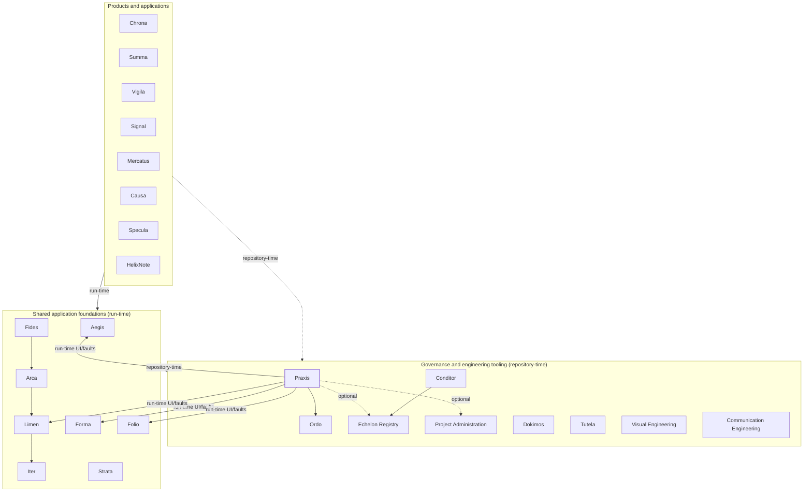

# Dependency and relationship map

## 1. Layers (as documented)

Most depended-on systems by declared edges: Praxis 38, Forma 27, Limen 24, Ordo 24, Aegis 20,
Folio 19, Visual Engineering 13, Communication Engineering 9, Conditor 8.

## 2. Cycles

A naive graph over all declared edges contains cycles. They resolve into two kinds once the **time** of
the dependency is distinguished:

| Cycle | Kind | Assessment |
|---|---|---|
| Praxis ↔ Aegis, Forma, Folio, Limen | Praxis consumes them at **run time** (requirements/SHARED-APPLICATION-FOUNDATIONS.md); they consume Praxis at **repository time** (installed work protocol and validation). | Not a run-time cycle. It is a **bootstrap coupling**: a broken Praxis release can block validation in the foundation repositories that Praxis itself needs. Mitigation: foundations pin Praxis by version, never "latest"; Praxis pins foundation releases (already required). Finding CYC-01. |
| Praxis ↔ Project Administration | Praxis registers installations **optionally**; Project Administration uses Praxis at repository time. | Acceptable: the optional side degrades to `unavailable` (registry invariant). |
| Conditor ↔ Echelon Registry | Conditor reads the registry as version authority; the registry requires Conditor release qualification before channel moves (REG-RU-007). | **Process coupling** by design. Risk: a Conditor defect can stall channel moves. Finding CYC-02 (document the manual override path). |
| Limen ↔ Visual Engineering | Limen installs the Visual Engineering context (build); Visual Engineering optionally consumes Limen. | Acceptable (optional side). |

No run-time cycle among foundations was found in the documentation. This was **not verified by
building a package graph**; verification method: resolve `*.fsproj`/`package.json` references of the
latest release of each foundation (roadmap item R-12).

## 3. Unnecessary hard dependencies (candidates)

| Dependency | Why it may be unnecessary | Evidence | Recommendation |
|---|---|---|---|
| Research repositories → research-publisher npm package (patched on postinstall in framework-engineering) | Tekmerion is the successor; npm distribution retired portfolio-wide | framework-engineering package.json; Praxis npm retirement DF-ROS-2026-A044 | migrate to Tekmerion release artifact (DRF-06) |
| Folio → Limen 0.7.1 declared but `notApplicable` | declared dependency that does not apply | folio foundations | remove declaration (DRF-07) |
| Applications → GitHub API directly for storage (Vigila host, Aegis store) | Arca is the shared GitHub-backed data layer | inventory batch A | evaluate consolidation (DUP-06), counterargument in duplication analysis |
| Foundation `required: true` declarations in pre-implementation repositories (Signal, HelixNote) | gate permanently red before code exists | organization administration quality inventory SIG-F1 | Praxis `deferred-until` state (already proposed there) |

## 4. Optional-provider independence

The Registry invariant (systems remain installable and functional when an optional provider is
absent) holds in documentation for Praxis→Registry, Praxis→Project Administration and capability
discovery. The new portfolio and repository manifest add **no run-time dependency** on the Registry
(REG-REPO-004): they are read by governance tooling only.

## 5. Relationships beyond dependencies

| Relationship | Examples |
|---|---|
| Successor / predecessor | time-tracking-application → Chrona; sales-and-marketing → Mercatus; Research Publisher → Tekmerion; ROS → Praxis; SDE → Ordo; typescript-wasm-kernel → Limen |
| Specialization | EDF is the intended first specialization of Causa's investigation kernel (Indy-init docs) |
| Research source | daf-landscape → Unbound requirements, EEF DAF case study |
| Observer | Specula observes repositories built by agents (no dependency) |
| Test target | causa-testing-repo, causa-write-test, gate-proof-r10 → Causa / Indy Init |

Machine-readable relationships belong in the Knowledge Store representation (see
`echelon-knowledge-store/research/portfolio-integration/requirements.md`), generated from
`portfolio/repositories.json` rather than maintained by hand.
